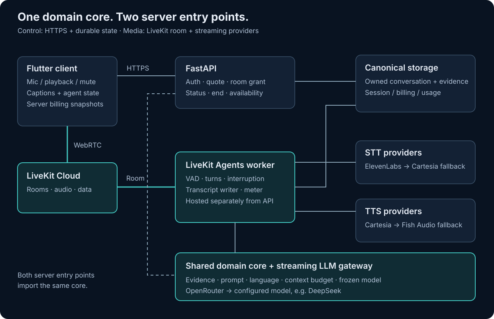

Lumina Tarot has a spoken follow-up conversation attached to an existing reading. The user talks naturally, the assistant replies aloud, either person can interrupt, and the conversation remains available as text afterward. The useful engineering result is a voice layer that another application can reuse: **LiveKit carries audio; separate providers recognize speech and synthesize replies; the application's own language model and business logic generate the answer.**

For our general persona, that language model is DeepSeek through OpenRouter. It is not embedded in the speech stack. We can change the recognizer, the voice, or the model integration independently, subject to the conversation's consistency rules.

This guide explains the implementation, the order in which to reproduce it, and two alternatives: an OpenAI stack informed by the open-source Codex voice implementation, and xAI's Grok voice stack. The central advantage of the modular approach is independent control over language quality, domain behavior, and cost. Lower total cost is an optimization opportunity, not a result that follows automatically from choosing a cheaper text model.

**Evidence and scope.** Implementation details below come from a static review of Lumina's private repository at commit `6392ec75f18c393eb5dda832e43190b2d7d4079e`. External APIs and prices were checked against official sources on **November 3, 2026**. This review did not rerun production voice calls, benchmark the three alternatives, or audit current provider invoices. Examples marked as assembly sketches or pseudocode require the application-owned components described alongside them; they are not a complete downloadable application. The guide includes those contracts so a second project can implement them without access to Lumina's repository.

## 1. The architecture to copy



There are two server entry points in one Python codebase:

- **FastAPI** authenticates users, authorizes the domain context, quotes a session, issues a room token, and exposes authoritative status and termination APIs.
- **A LiveKit Agents worker** joins the room and runs the streaming STT → LLM → TTS conversation. It imports the same domain core used by the text API.

The Flutter client sends audio to LiveKit Cloud and plays the agent's remote audio track. It also receives transcripts, agent state, and billing snapshots. Audio is not uploaded to the REST API one recorded utterance at a time.

The distinction matters. **REST is the control plane; LiveKit is the media plane.** Firestore is the durable authority for account/session state and canonical conversation history. A room event is useful for a responsive UI, but it is not the final billing record or the explanation for why the server ended a session.

In this implementation, LiveKit Cloud hosts the media service while our application hosts the agent worker. Those are separate deployment choices. LiveKit documents [self-hosted agent deployments](https://docs.livekit.io/deploy/custom/deployments/) as well as managed hosting; using its SDK does not require putting our business logic inside a proprietary assistant product.

## 2. The actual stack, including fallbacks

This is the repository configuration reviewed for this article, rather than a claim that each item is the newest available model:

| Responsibility | Lumina implementation | Migration seam |
|---|---|---|
| Client | Flutter, `livekit_client` declared as `^2.11.0`, `permission_handler` | Keep an application-owned room interface around the SDK |
| Media transport | LiveKit Cloud rooms and WebRTC audio tracks | Managed or self-hosted transport, independently of the LLM |
| Conversation orchestration | `livekit-agents==1.6.10` | One orchestrator owns turn-taking and cancellation |
| Voice activity detection | Silero VAD, prewarmed per worker process | Tune against real pauses and false interruptions |
| Primary STT | ElevenLabs `scribe_v2_realtime` | Streaming recognizer plugin |
| Fallback STT | Cartesia `ink-whisper` | A separately tested language/configuration path |
| Domain LLM | Shared application gateway through OpenRouter Chat Completions | Same domain core and conversation model as text |
| General persona model | `deepseek/deepseek-v4-flash` | Model belongs to persona configuration |
| Primary TTS | Cartesia `sonic-3`, persona-specific voice ID | Streaming synthesis plugin |
| Fallback TTS | Fish Audio plugin, `latency_mode="low"` | App does not explicitly pin its model/voice in this constructor |
| Identity and storage | Firebase Auth and Firestore | Replaceable auth/store adapters; keep authorization semantics |
| API hosting | Cloud Run | Request-serving process |
| Voice worker hosting | Repository's current runbook: VPS + systemd | Long-running worker, independently released and verified |

The Cartesia, ElevenLabs, Fish Audio, and Silero LiveKit plugins are also pinned to `1.6.10` in the reviewed Python dependency file. Python's minimum is 3.12. Keep a lockfile in the destination project; copying a caret range from Flutter is not the same as copying the resolved dependency graph.

The provider integration references are [ElevenLabs STT](https://docs.livekit.io/agents/models/stt/plugins/elevenlabs/), [Cartesia TTS](https://docs.livekit.io/agents/models/tts/plugins/cartesia/), and [Fish Audio TTS](https://docs.livekit.io/agents/models/tts/plugins/fishaudio/). Provider docs evolve independently of the pinned application. For example, Cartesia now publishes a [Sonic 3 → 3.5 migration guide](https://docs.cartesia.ai/build-with-cartesia/tts-models/sonic-3-to-sonic-3-5); that is a reason to evaluate an upgrade, not evidence that Lumina already runs it.

### Which APIs are involved?

| Connection | API or protocol | Credential owner |
|---|---|---|
| Flutter → application | Authenticated HTTPS REST under `/api/v1/voice` | User identity token |
| Flutter ↔ LiveKit | Room signaling plus WebRTC media/data | Short-lived room-scoped token from our API |
| Worker ↔ LiveKit | Agents registration, job assignment, room participation | Worker-side LiveKit credentials |
| Worker → ElevenLabs | Realtime STT WebSocket, `wss://api.elevenlabs.io/v1/speech-to-text/realtime` | Server-side ElevenLabs key |
| Worker → Cartesia/Fish Audio | Streaming synthesis/recognition via provider plugins | Server-side provider keys |
| Domain gateway → OpenRouter | `POST https://openrouter.ai/api/v1/chat/completions`, streamed text | Server-side OpenRouter key |
| API/worker → Firestore | Firebase Admin / Google Cloud server SDK | Service identity with limited permissions |

Use the plugin to handle provider audio framing and connection behavior unless a measured requirement justifies a custom adapter. ElevenLabs' [realtime API reference](https://elevenlabs.io/docs/api-reference/speech-to-text/v-1-speech-to-text-realtime) is the relevant contract for the deployed recognizer; a batch transcription endpoint with a similar model name is not a substitute.

## 3. Keep domain intelligence outside the voice framework

The most important module is not a speech plugin. It is the shared domain core.

In a tarot app it supplies the reading, source evidence, persona, conversation history, language preference, and context budget. In another project it might supply a lesson, support case, order, or document. These are adapters around the same invariant:

**Changing input/output modality must not silently change the facts, permissions, or model responsible for the domain answer.**

A useful destination layout is:

```text
app/
  core/
    context.py          # domain evidence, history, language, budget
    prompts.py          # persona and response policy
    llm.py              # streaming model gateway and usage
    pricing.py          # pure authorization/billing arithmetic
  api/
    voice.py            # quote/start/status/end
  voice/
    entrypoint.py       # LiveKit job and provider assembly
    domain_llm.py       # framework LLM interface -> core
    transcripts.py      # durable final/interrupted turns
    meter.py            # server authority and termination
  repositories/
    conversations.py
    voice_sessions.py
```

Both entry points import `core`. The voice worker does **not** loop back through the public text endpoint to obtain an answer. Lumina makes this a deliberate boundary: the public endpoint has its own transport, billing, and retry semantics, which should not become a second voice pipeline. Another application can use an internal domain service instead of a Python import, but then it must preserve the same versioned context/model contract.

### Model selection is flexible; an active conversation is stable

Lumina calls its persona configuration a *soul*. It combines the prompt, model, voice, context budget, reasoning policy, and price. A different persona can intentionally use a different model. An existing conversation, however, records its model identity. A voice session must agree with it.

That separates three changes people often conflate:

1. **Routing the same model through another compatible upstream host:** an availability decision.
2. **Selecting another model for a new persona/conversation:** an explicit product/configuration decision.
3. **Replacing the model halfway through an existing conversation:** a consistency change that needs a migration or a new conversation, not an invisible retry.

The general persona's current model is DeepSeek. Other personas have their own configurations. It would be inaccurate to describe the whole application as permanently tied to one DeepSeek model.

## 4. Reproduce the control-plane lifecycle first

Lumina starts voice from an existing, authorized interpretation. A destination app should replace that eligibility check with its own domain rule rather than copying tarot identifiers into its storage model.

### Quote → consent → start → connect

The public operations are:

| Operation | Endpoint | Important behavior |
|---|---|---|
| Quote | `GET /api/v1/voice/quote` | Domain eligibility, availability, price, balance, processing disclosure |
| Start | `POST /api/v1/voice/sessions` | Revalidate quote; create pending record; issue room grant; return 201 |
| Recover status | `GET /api/v1/voice/sessions/{id}` | Authoritative state, billing revision, balance, and end reason |
| End | `DELETE /api/v1/voice/sessions/{id}` | Idempotent termination/settlement; return 204 |

For a daily reading, quote query parameters include `readingKind=cotd`, `date`, and `drawId`. A spread uses `readingKind=spread` and `spreadReadingId` instead. Do not accept a mixture of both locator shapes.

The start request echoes the revisions the user saw in the quote:

```json
{
  "readingKind": "cotd",
  "date": "2026-11-03",
  "drawId": "example-draw-id",
  "runtimeRevision": 7,
  "pricingRevision": "example-pricing-revision"
}
```

These values are illustrative. The real values come from the quote, not a client constant. The response grants a particular session and room:

```json
{
  "voiceSessionId": "example-session-id",
  "roomName": "voice-example-session-id",
  "token": "<short-lived-room-token>",
  "livekitUrl": "wss://<your-livekit-project-host>",
  "keyterms": ["example domain term"],
  "soulId": "general",
  "blockSeconds": 12,
  "creditsPerBlock": 1,
  "creditsPerMinute": 5,
  "pricingRevision": "example-pricing-revision",
  "runtimeRevision": 7
}
```

The server authenticates the user, checks ownership, re-quotes against current availability/pricing, and rejects stale revisions. It transactionally enforces one pending/active voice session per account. It persists `pending` before returning the token. If token creation fails, cleanup releases the orphaned pending record. The current token lifetime is 300 seconds and the grant is restricted to the room and user identity; token expiry is an admission boundary, not a substitute for ending an already-connected call.

The API's error contract includes:

| HTTP | Code | Client response |
|---|---|---|
| 402 | `INSUFFICIENT_CREDITS` | Offer the application's purchase/top-up route |
| 409 | `VOICE_QUOTE_STALE` | Fetch and present a fresh quote |
| 409 | `VOICE_SESSION_ALREADY_ACTIVE` | Recover/end the existing session |
| 404 | `INTERPRETATION_NOT_READY` | Return to domain eligibility flow |
| 503 | `VOICE_UNAVAILABLE` | Preserve the conversation and allow retry/text mode |

Starting a pending session does not itself spend credits. The worker validates the stored session and context, starts provider/session machinery, then authorizes the first billing block before allowing user input. Never charge merely because the client requested a token.

### Client responsibilities

The Flutter room wrapper calls `room.connect(grant.livekitUrl, grant.token)` and then `localParticipant.setMicrophoneEnabled(true)`. It owns mute/unmute and disconnect cleanup. The controller coordinates permission, quote display, connection, and account changes.

Keep platform microphone permission and audio-session setup in the client. Use the platform/SDK's appropriate capture and playback processing, including echo cancellation; verify it on the actual output route rather than claiming a particular SDK default is universally sufficient. STT, TTS, end-of-turn decisions, and model generation stay on the server.

The useful UI states are `connecting`, `listening`, `thinking`, `speaking`, `reconnecting`, and terminal `ended`/failure states. Lumina reads agent state from `lk.agent.state`, uses LiveKit transcription events for captions, and listens for reliable data messages with topic `billing_state`. Account identity and a controller generation counter guard asynchronous callbacks so a previous account/session cannot update the next one.

On disconnect, call the status endpoint. A WebRTC disconnect does not tell the client whether the business reason was idle timeout, exhausted credit, provider failure, or worker shutdown. After termination, refresh canonical history with bounded retry: the worker may still be draining its final transcript write.

## 5. Assemble the streaming worker

The following is an **assembly sketch using the reviewed SDK shape**. `domain_llm`, the frozen `persona`, settings, and the prewarmed VAD are application-owned inputs; the next section defines the adapter contract. It intentionally leaves out session authorization, event wiring, and persistence so those responsibilities remain visible rather than hidden in a misleading demo.

```python
from livekit.agents import AgentSession
from livekit.agents.stt import FallbackAdapter as SttFallbackAdapter
from livekit.agents.tts import FallbackAdapter as TtsFallbackAdapter
from livekit.plugins import cartesia, elevenlabs, fishaudio


def build_voice_session(settings, persona, domain_llm, vad, context_hint):
    return AgentSession(
        vad=vad,
        turn_handling={
            "endpointing": {"min_delay": 0.3},
            "interruption": {"mode": "vad", "min_duration": 0.25},
        },
        stt=SttFallbackAdapter(stt=[
            elevenlabs.STT(
                api_key=settings.elevenlabs_api_key,
                model="scribe_v2_realtime",
                previous_text=context_hint,
                server_vad={
                    "vad_silence_threshold_secs": 0.6,
                    "min_silence_duration_ms": 600,
                    "min_speech_duration_ms": 250,
                    "vad_threshold": 0.4,
                },
            ),
            cartesia.STT(
                api_key=settings.cartesia_api_key,
                model="ink-whisper",
            ),
        ]),
        llm=domain_llm,
        tts=TtsFallbackAdapter(tts=[
            cartesia.TTS(
                api_key=settings.cartesia_api_key,
                model="sonic-3",
                voice=persona.tts_voice,
            ),
            fishaudio.TTS(
                api_key=settings.fishaudio_api_key,
                latency_mode="low",
            ),
        ]),
    )
```

In Lumina, secrets are wrapped in settings types and explicitly unwrapped at assembly. The simplified example assumes strings. Load them only into server processes. The relevant environment settings are `LIVEKIT_URL`, `LIVEKIT_API_KEY`, `LIVEKIT_API_SECRET`, `ELEVENLABS_API_KEY`, `CARTESIA_API_KEY`, `FISHAUDIO_API_KEY`, and `OPENROUTER_API_KEY`, plus your datastore identity and domain-content configuration. Never ship those provider secrets in the mobile build.

**Prewarm before a user arrives.** Load Silero once in the worker's prewarm hook and reuse it through process userdata. The repository also warms the OpenRouter connection and the TTS path. Model initialization, DNS/TCP/TLS, and an empty connection pool all otherwise land on the first audible response.

The worker entry point runs a production worker command, `python -m app.agent.entrypoint start`, registers with LiveKit, and handles assigned rooms. For each room it verifies the pending session and participant identity, loads the owned conversation snapshot, builds one long-lived domain LLM adapter, wires transcript/meter/shutdown events, and starts the `AgentSession` with the room and agent instructions. Let one orchestration framework own this lifecycle. Pipecat could replace LiveKit Agents as the orchestrator; running two competing high-level turn/cancellation loops would make behavior harder to reason about.

### The domain LLM adapter is the production integration

Lumina's `VoicePinnedLlm` implements LiveKit's `LLM` interface. Despite its historical name, the current gateway uses an upstream provider pool rather than a fixed host chain. Its job is to:

1. Extract the newest final user text from the framework's chat context.
2. Normalize only narrowly defined domain recognition errors.
3. Resolve the account's response language and any explicit language-switch request.
4. Build input from the canonical domain snapshot, rolling summary, confirmed messages, and current user turn.
5. Enforce the context budget; summarize an older complete prefix when necessary.
6. Stream through the shared LLM gateway with the conversation's model, converting text deltas into LiveKit `ChatChunk` events and usage into `CompletionUsage`.

A neutral version of that contract looks like this **pseudocode**:

```python
async def generate_voice_turn(snapshot, final_user_text, domain_core):
    request = domain_core.prepare_turn(
        snapshot=snapshot,
        text=final_user_text,
        modality="voice",
        require_same_model=True,
    )
    # request contains canonical evidence, confirmed history, language,
    # context budget and the frozen model identity.
    async for event in domain_core.stream(
        request,
        first_content_timeout_seconds=8,
    ):
        if event.kind == "text_delta":
            yield to_livekit_chat_chunk(event.text)
        elif event.kind == "usage":
            yield to_livekit_usage(event)
```

Implement `prepare_turn`, `stream`, and the two conversion functions in the destination project. Keep the adapter alive for the whole voice session: rebuilding it each utterance would discard its in-memory summary and accepted history. Persistence belongs to a transcript writer, not this adapter; it should not independently charge the user or own a Firestore repository.

Voice adds a short-opening instruction to the user-turn material, leaving the persona system prompt stable. The reviewed personas configure voice reply reasoning off and reserve a maximum of 2,048 output tokens. Those are configuration choices, not universal optimal values; confirm a candidate model actually honors the relevant reasoning controls.

The current upstream routing policy is:

```json
{
  "quantizations": ["fp8"],
  "sort": "latency",
  "allow_fallbacks": true,
  "data_collection": "deny",
  "zdr": true
}
```

These are OpenRouter-specific routing controls, documented in its [provider routing guide](https://openrouter.ai/docs/guides/routing/provider-selection). They select eligible hosts for the requested model; they do not authorize changing the model. Copy `fp8` only if your chosen model has compatible endpoints. The reviewed gateway also has an **8-second first content token timeout**: a connection that only emits keepalives is not useful progress. A provider routing preference cannot guarantee a response-time SLA.

## 6. Interruptions, transcripts, and language are one design problem

### Distinguish four clocks

Voice activity, end-of-turn detection, playback, and billing have different clocks. Treating any two as equivalent causes subtle errors.

- **VAD** identifies speech activity. The reviewed minimum speech duration is 250 ms.
- **Endpointing** decides when a natural pause is a completed user turn. Current silence settings include 600 ms and a 0.3-second minimum endpointing delay; they are not a promise that the total delay is their arithmetic sum.
- **Interruption detection** decides when user speech should stop the agent. Current mode is `vad` with a 0.25-second minimum duration. Shortening it can increase false interruptions.
- **Playback completion** identifies what the user could actually hear. TTS finishing generation does not mean the device finished playing.

Use the current SDK's supported configuration shape. This codebase had already moved interruption controls into `turn_handling`; carrying an old top-level keyword into a new SDK version can silently change behavior.

### Persist the delivered answer

On a final user transcription, write the user message into the canonical conversation. Empty/whitespace input must not silently become a real turn. Partial captions can appear in the UI without becoming durable history.

For the assistant, wait for the speech/playout lifecycle rather than the synthesizer's completion callback. If interrupted, persist the delivered prefix with interrupted status, not the unplayed generated tail. If no assistant content was delivered, abandon that pending response cleanly. Use request IDs and store-side sequencing to make retries idempotent, release the conversation lease, and avoid leaving the next turn permanently busy.

Lumina stores voice turns in the same conversation message sequence as text, marked `medium=voice` and linked to `voiceSessionId`. It does not create a second, incompatible chat-history model. This also prevents charging a voice turn a second time through the text follow-up billing path.

### Evaluate the exact recognition path

The current ElevenLabs constructor passes a context hint through `previous_text`. That is not evidence that a special hotword API is active, nor that every recognizer honors the same biasing fields. The [realtime contract](https://elevenlabs.io/docs/api-reference/speech-to-text/v-1-speech-to-text-realtime) and the pinned plugin's mapping must agree. Test the actual WebSocket recognizer with real human recordings.

For Chinese, English, and mixed speech, evaluate at least proper nouns, short stop commands, domain terms, numbers, self-corrections, pauses, and code-switching. Keep recognition language, the language of source evidence, and the desired reply language separate. Lumina's account `chatLanguage` preference governs replies; an explicit request to switch language can change it, while casually uttering a foreign-language word should not.

Fallback recognition needs its own evaluation. The reviewed Cartesia fallback constructor does not explicitly set a language. Do not infer Chinese parity from the primary recognizer's results, or from a provider's general multilingual marketing. Likewise, the Fish Audio fallback can change vocal identity because the application does not pass the Cartesia voice ID to it. Availability fallback and persona fidelity are separate acceptance criteria.

## 7. Meter the session on the server

Voice is billed by session authorization blocks, not by the number of generated messages. In the reviewed general persona, **one credit authorizes 12 seconds**, equivalent to five credits per minute. These are product credits, not provider dollars, and other persona configurations can differ.

The server freezes price/revision information when the session starts. A meter authorizes the first block and then checks on a configurable tick, currently 10 seconds. Repository transactions purchase further blocks using the expected previous authorization boundary. This makes competing ticks and repeated settlement safe against duplicate debits.

A status or `billing_state` message includes:

```text
voiceSessionId, revision, startedAt, elapsedSeconds,
authorizedThroughSeconds, blockSeconds, creditsPerBlock,
creditsPerMinute, billedCredits, remainingCredits
```

The client discards a snapshot for another session or a non-increasing revision. It may animate an elapsed clock locally, but it does not debit credits locally. On recovery it reads the server snapshot again. A UI field called `billedMinutes` should not replace the authoritative block/credit fields when the actual price uses shorter blocks.

All termination routes converge on settlement: user hangup, disconnect, provider failure, exhausted credit, runtime disable, and worker shutdown. Final usage and transcript writes must be drained; stale sessions are reclaimed using the last heartbeat, not simply because a healthy call has been running for a long time.

The 90-second idle watchdog has a different purpose from billing. It pauses while the agent speaks and starts a fresh idle window when the agent stops speaking; user speech resets it. Wall-clock billing still runs. Otherwise a long answer could terminate itself because the polite listener did not interrupt. Freeze elapsed time at the termination decision where appropriate, so an explanatory closing announcement does not itself push the user into another charged block.

## 8. Deploy and operate the whole system

The reviewed repository describes **FastAPI on Cloud Run and the voice worker on a VPS under systemd**. A retained `deploy_voice_worker.sh` is explicitly a historical Cloud Run worker-pool/rollback reference. Do not copy an old deployment command just because the filename looks current. This article verifies the repository runbook, not a live VPS inventory.

A destination worker unit can follow this generic shape:

```ini
[Unit]
Description=Application voice agent
After=network-online.target
Wants=network-online.target

[Service]
User=voice-agent
WorkingDirectory=/srv/voice-app/backend
EnvironmentFile=/etc/voice-app/worker.env
ExecStart=/srv/voice-app/backend/.venv/bin/python -m app.agent.entrypoint start
Restart=on-failure
RestartSec=3
KillSignal=SIGTERM
TimeoutStopSec=120

[Install]
WantedBy=multi-user.target
```

Provision the user, paths, virtual environment, data assets, and a root-managed environment file readable by the service. Prefer workload identity where available; if a VPS requires a service-account key, restrict its permissions and rotation surface. Do not copy project IDs, credentials, local home paths, or production room tokens from another application.

For a first destination rollout:

1. Deploy domain/API code with new-session availability disabled.
2. Deploy the worker from the same release, including matching prompts and domain data.
3. Read a startup attestation: model, provider policy revision, voice, and prompt/data fingerprints; confirm worker registration.
4. Run an authenticated room smoke test and a real device audio test.
5. Enable availability with a compare-and-set revision; quote/start must agree on it.
6. On rollback, disable admission first, drain or explicitly terminate existing sessions according to policy, and settle before stopping workers.

A running process or successful deploy exit is not proof of a working speech chain. Watch worker registration, assigned jobs, provider errors, time to first content token, first audible output, cancellation time, loop lag/CPU, active sessions, orphaned pending sessions, and canonical transcript write failures. Test under concurrency: a prewarmed VAD on a busy worker can behave differently from a single-user laptop demo.

Transport encryption does not mean that recognition, model, and synthesis providers cannot process the content. Keep the user-facing processor disclosure synchronized with every active primary/fallback provider. Lumina's quote contract exposes `processors` and `storesRawAudio`; the migration should set those from a verified processing inventory. Application-side absence of raw-audio storage is not a claim that every upstream has zero retention. OpenRouter privacy routing also applies only to that LLM hop.

### A read-aloud button is a different pipeline

Lumina also synthesizes already-generated reading text for playback. That path can share the Cartesia model and persona voice configuration, but it is not the realtime follow-up room. Read-aloud has text rendering, audio encoding, caching, and playback concerns; live conversation has microphone input, turn-taking, interruption, and session metering. Invalidate cached audio when text, synthesis version, model, or voice identity changes. Keep shared synthesis constants in a lightweight module rather than importing the whole worker into the API process.

## 9. A migration sequence that reaches a usable product

The following order avoids building a voice demo that must later be rewritten to fit the domain.

| Step | Build | Evidence to collect before moving on |
|---|---|---|
| 1 | Shared context/model gateway | Same owned domain snapshot and model identity for text and voice preparation |
| 2 | Quote/start/status/end API and store | Ownership, stale revision, concurrent starts, token failure cleanup |
| 3 | One room with primary STT/LLM/TTS | Real mic → final transcript → domain answer → audible playback |
| 4 | Interruptions and canonical history | Interrupt before speech, mid-sentence, and near completion; no unplayed tail or stuck lease |
| 5 | Client lifecycle | Permission denial, mute, Bluetooth/speaker route, reconnect, backgrounding, account switch, hangup |
| 6 | Server authorization/meter | Repeated ticks, block boundary, exhausted balance, idle timeout, shutdown, stale recovery |
| 7 | Fallbacks and language matrix | Deliberately break each provider; verify Chinese, English, mixed terms and voice changes |
| 8 | Staged deployment and usage reconciliation | Registered worker, matched release fingerprints, final history, complete provider costs |

Replace five domain-specific pieces: eligibility/ownership lookup, canonical evidence snapshot, persona/prompt policy, history/context-budget store, and product pricing. Preserve the transport/worker/client boundaries and lifecycle tests. The destination need not use Firebase, Flutter, or tarot data to keep this design.

In Lumina, useful source entry points for the owner are `backend/app/agent/entrypoint.py`, `voice_llm.py`, `transcript_writer.py`, `meter.py`, `billing_publisher.py`, `backend/app/api/v1/endpoints/voice.py`, `backend/app/services/voice_session_service.py`, `voice_quote_service.py`, `backend/app/repositories/voice_session_repository.py`, and `lib/reading_followup/voice/`. These are private implementation pointers, not prerequisites for following this guide.

Measure latency from **end of user speech to first audible agent output**, then split it into endpointing, final STT, context assembly, LLM first content/first speakable phrase, TTS first frame, and transport/playout. Report p50 and tail percentiles alongside sample count, language, region, load, and warm/cold state. Historical POC numbers from another provider combination are not current production benchmarks. This guide deliberately makes no universal sub-second or 1.5–2.5-second claim.

## 10. Alternative A: an OpenAI stack, with Codex as an architecture reference

The open-source [Codex repository](https://github.com/openai/codex) contains a real interactive voice implementation. For a reproducible reference, this review pinned it to commit **`781d89b91e2487c3653208b9c13287e1a09f6f04`**.

The useful source map is:

| Source | What to learn from it |
|---|---|
| [`tui/src/app_server_session/realtime.rs`](https://github.com/openai/codex/blob/781d89b91e2487c3653208b9c13287e1a09f6f04/codex-rs/tui/src/app_server_session/realtime.rs) | TUI starts realtime with WebRTC, V3, audio output, and client-managed handoffs |
| [`realtime-webrtc/src/session.rs`](https://github.com/openai/codex/blob/781d89b91e2487c3653208b9c13287e1a09f6f04/codex-rs/realtime-webrtc/src/session.rs) | Local voice helper, SDP negotiation, device/mute lifecycle |
| [`core/src/realtime_conversation.rs`](https://github.com/openai/codex/blob/781d89b91e2487c3653208b9c13287e1a09f6f04/codex-rs/core/src/realtime_conversation.rs) | Realtime state, transcripts, delegation, backend results |
| [`core/src/context/realtime_delegation.rs`](https://github.com/openai/codex/blob/781d89b91e2487c3653208b9c13287e1a09f6f04/codex-rs/core/src/context/realtime_delegation.rs) | Explicit handoff from spoken conversation to background work |

The architectural lesson is **a responsive voice front end delegating substantive work to a backend agent**. Do not equate the conversational voice model with the model executing coding tasks. At this commit, Codex's V3 default is `gpt-live-1-codex`; older protocol paths retain `gpt-realtime-1.5`. That is not proof that a third-party app should request the Codex-specific model ID, use a ChatGPT backend endpoint, or reuse a consumer login token. Open-source client code is also not evidence that the hosted models and the entire service behind it are open source.

### Public implementation: GPT-Live plus an OpenAI backend

For a new application, the closest public counterpart is [GPT-Live](https://developers.openai.com/api/docs/guides/live): a full-duplex spoken conversation layer that delegates reasoning and tools. A full OpenAI implementation uses **`gpt-live-1` + a Responses backend model + application-authorized tools**. The voice layer can listen while speaking, while the backend performs longer work. [Official delegation documentation](https://developers.openai.com/api/docs/guides/live-delegation) describes the separation.

```text
Client microphone/speaker
          ↕ WebRTC
       GPT-Live
          ↕ delegation and progress/results
   OpenAI Responses backend
          ↕ authorized application tools
       Domain services
```

The domain backend must still own access control, durable task state, confirmation for consequential actions, and canonical records. A model-generated tool request is not authorization.

There is an important hybrid option: **GPT-Live client delegation can call an application's own model, agent, or service.** It could therefore keep Lumina's DeepSeek domain core. OpenAI is not limited to an all-OpenAI backend. What changes is control over the speech front end: STT and TTS are no longer independently selected as in our cascade. If the voice layer paraphrases a domain answer, evaluate whether that satisfies the product's same-answer requirement. See [delegation modes](https://developers.openai.com/api/docs/guides/live-delegation).

GPT-Live has its own public session API; the [model page](https://developers.openai.com/api/docs/models/gpt-live-1) lists `v1/live/sessions`. Do not paste a Realtime session payload or endpoint into a GPT-Live example and assume compatibility.

### A separate OpenAI option: Realtime speech-to-speech

OpenAI also offers [Realtime](https://developers.openai.com/api/docs/guides/realtime), including `gpt-realtime-2.1` and `gpt-realtime-2.1-mini`. This is another public speech-to-speech route, with WebRTC/WebSocket, session events, tools, and server-side controls. For client access, the application backend creates a short-lived credential via `POST /v1/realtime/client_secrets`; the [WebRTC flow](https://developers.openai.com/api/docs/guides/voice-webrtc?api=realtime) uses `/v1/realtime/calls`.

This is **not** the same API or pricing model as GPT-Live. For a destination project, choose one contract first and implement its event, interruption, credential, and tool lifecycle faithfully.

OpenAI reduces the amount of speech orchestration we own and is attractive when conversational responsiveness and rapid integration matter most. The tradeoffs are speech-provider dependence, a different cost structure, and the work needed to integrate domain consistency and history. Independent provider selection remains more granular in the Lumina cascade; backend model choice is not exclusive to it.

For new implementations, check [OpenAI's deprecation notices](https://developers.openai.com/api/docs/deprecations). The Realtime beta was removed on May 12, 2026; do not build against old beta headers. Legacy `gpt-realtime`/`gpt-realtime-mini` are scheduled for removal on January 20, 2027, and older TTS models have their own retirement schedule. Pin the intended API/model and keep a migration check in the release process.

## 11. Alternative B: Grok Voice through xAI

xAI's current [Speech to Speech API](https://docs.x.ai/developers/model-capabilities/audio/speech-to-speech) connects over:

```text
wss://api.x.ai/v1/realtime?model=grok-voice-3.0
```

At the review date, `grok-voice-latest` points to 3.0 and 2.0 is deprecated. Use a fixed model for reproducible evaluation; an alias can change behavior. The native path puts the conversational speech model on xAI rather than independently selecting three vendors.

The application server obtains a short-lived client token from `POST https://api.x.ai/v1/realtime/client_secrets`. Its [ephemeral-token guide](https://docs.x.ai/developers/model-capabilities/audio/ephemeral-tokens) shows `expires_after.seconds`, for example 300 seconds. A mobile/web client should never receive the permanent xAI API key.

The connection flow is:

1. Authenticate the application user and authorize the domain session.
2. Obtain a short-lived token on the backend.
3. Connect the client or a controlled audio bridge to the WebSocket.
4. Send `session.update` with instructions, a supported voice, input/output formats, turn detection, and tools.
5. Stream audio and handle transcript/audio events; execute application functions behind server authorization.
6. On interruption, cancel generation as appropriate **and stop/clear local playback**. Truncate unplayed conversation content so model history does not imply the user heard it.
7. Reconcile final history, usage, and application session state on termination.

The [voice API reference](https://docs.x.ai/developers/rest-api-reference/inference/voice) specifies cancellation/truncation events. A WebSocket gives the application direct control, but also leaves audio buffering and device playback responsibilities that a managed room/SDK may otherwise cover. For a WebRTC client, xAI publishes a [WebRTC bridge example](https://docs.x.ai/cookbook/examples/voice-agent-webrtc): the application-side media bridge connects to xAI over WebSocket. That should not be described as the same native WebRTC service contract as OpenAI's endpoint.

Grok supports tools including custom functions and hosted search capabilities. Application function arguments still need validation, identity checks, write authorization, and idempotency. Tool fees can be additional to voice fees. Its documentation includes Chinese support, but support is not a measured claim about Chinese accuracy, accent handling, terminology, or mixed-language quality relative to our providers.

xAI also exposes **separate STT and TTS APIs**, including REST and streaming endpoints. They can be components in a custom cascade with a third-party LLM. Thus the real comparison is *native Grok speech-to-speech versus an independently assembled pipeline*, not an assertion that every xAI product prevents modular composition. See its [voice overview](https://docs.x.ai/developers/model-capabilities/audio/voice), [STT](https://docs.x.ai/developers/model-capabilities/audio/speech-to-text), and [TTS](https://docs.x.ai/developers/model-capabilities/audio/text-to-speech) documentation.

## 12. Compare flexibility, experience, and cost fairly

| Criterion | Lumina-style cascade | OpenAI native voice / delegation | Grok native speech-to-speech |
|---|---|---|---|
| Speech recognition | Independently select and evaluate primary/fallback | Managed inside the native speech layer | Managed inside native Grok voice |
| Domain LLM | Application-controlled; DeepSeek is one configuration | All-OpenAI backend, or custom backend through GPT-Live delegation | Grok native model; external domain computation can be reached through tools |
| Voice synthesis | Independently select provider/voice/fallback | Integrated voice layer | Integrated voice layer; built-in/custom voices |
| Domain text parity | Direct generation through shared core | Must verify delegation/rephrasing behavior | Must verify tool/result/rephrasing behavior |
| Language optimization | Tune each component, including mixed-language failure cases | Evaluate native speech experience as a whole | Evaluate native speech experience as a whole |
| Interaction | Framework turn detection and barge-in; more seams to tune | GPT-Live offers full-duplex conversation and delegation | Native session VAD, audio events, tools |
| Operations | API + media service + worker + multiple vendor connections | Less separate speech orchestration; domain backend still required | Less separate speech orchestration; WebSocket media lifecycle still required |
| Failure recovery | Fine-grained fallback and diagnostics, more states | API/session-specific recovery | API/session-specific recovery |
| Cost control | Independent rates, model choice, routing, worker utilization | Voice charges plus backend/tools or audio-token billing | Native voice duration plus text-input/tools charges |

### Current public price references

These are **different meters**, not interchangeable per-minute totals:

| Product | Public price checked November 3, 2026 | What else to account for |
|---|---|---|
| OpenAI `gpt-live-1` | $0.05/minute, billed per second | Backend model and tools are additional |
| OpenAI `gpt-realtime-2.1` | Audio input $32 / output $64 per 1M tokens; cached audio input $0.40 | Text tokens and other usage have separate rates |
| OpenAI `gpt-realtime-2.1-mini` | Audio input $10 / output $20 per 1M tokens; cached audio input $0.30 | Same token-versus-duration distinction |
| xAI Grok Voice 3.0 | $0.08/minute plus $0.004 per billable text input | Hosted tools may add fees; billing depends on turn mode |
| xAI separate STT | REST $0.10/hour; streaming $0.20/hour | Not the native voice-session tariff |
| xAI separate TTS | $15 per 1M characters | LLM, transport and app hosting remain separate |

Sources: [OpenAI pricing](https://developers.openai.com/api/docs/pricing), [GPT-Live model pricing](https://developers.openai.com/api/docs/models/gpt-live-1), [xAI pricing](https://docs.x.ai/developers/pricing), and [Grok speech-to-speech billing details](https://docs.x.ai/developers/models/speech-to-speech). Old xAI examples quoting $0.05/minute are not the current Voice 3.0 tariff.

For xAI's default `server_vad`, audio billing follows **session duration**, so silence matters. Push-to-talk bills audio sent and received instead. The text-input fee has exceptions, including function-call outputs and audio input items; do not multiply every protocol event by $0.004. Consult the billing details rather than treating all modes as identical.

To evaluate our cascade, calculate:

```text
session cost =
    STT billed duration × recognizer rate
  + LLM input/cache/output tokens × applicable rates
  + TTS billed characters/audio × synthesizer rate
  + LiveKit transport/connection charges under the actual plan
  + allocated worker + API + storage/network cost
  + failed/retried/fallback usage not already included above
```

Use actual billable units, including provider-specific silence and rounding rules. Do not assume a recognizer charges only human speaking time. Fixed VPS cost divided across a nearly idle app can dominate; spare capacity on an existing VPS can make incremental hosting inexpensive, but it is not a portable zero-dollar hosting assumption.

Lumina records STT seconds and TTS characters/audio by provider, transport seconds, and LLM usage linked through `voiceSessionId`. A missing or incomplete usage record is **unknown**, not free. The reviewed cost tooling still treats some Cartesia credit-to-dollar conversions as unknown; a reported subtotal must not be presented as a verified all-in cost. Get contractual/account pricing or reconcile invoices before claiming a cost advantage.

For a deliberately narrow illustration, 10 minutes at the published GPT-Live voice rate is **$0.50 before backend/tools**. Ten default-VAD minutes at Grok Voice 3.0's audio rate is **$0.80 before billable text inputs/tools**. Neither number is our measured product cost, and neither establishes a quality-equivalent comparison. Our cascade is cheaper for a workload only if its fully accounted total is below the competing workload's fully accounted total. Re-evaluate after changing language mix, reply length, model, voice, provider plan, or worker utilization.

Choosing a lower-cost DeepSeek text model can reduce the LLM term substantially for an appropriate workload. It cannot by itself establish that the whole voice conversation is cheaper than every OpenAI or Grok configuration. The lasting advantage is that each term remains independently tunable.

## 13. Choosing a starting point for the next project

Use the Lumina pattern when the domain answer must come from a specific model or evidence pipeline, Chinese/mixed-language evaluation requires independent STT/TTS choices, or vendor-level cost and fallback control are central requirements. Budget for the lifecycle and operational work described above.

Use an OpenAI native voice layer when fast integration and conversational responsiveness matter more than independently selecting speech components. For a Codex-like assistant that works while the user keeps talking, evaluate GPT-Live delegation; a custom backend can preserve existing domain intelligence. Use the separate Realtime API when that session/model contract fits the intended application.

Use native Grok Voice when its conversational behavior, voices, tool ecosystem, and measured language quality fit the product, and its duration/text-input tariff works for the expected workload. Its separate STT/TTS APIs are also candidates for a modular design.

Whichever route you choose, retain application ownership of authorization, canonical domain context, durable history, consequential tool actions, and cost records. Those boundaries are what make voice portable across projects, even when every provider in the chain changes.
