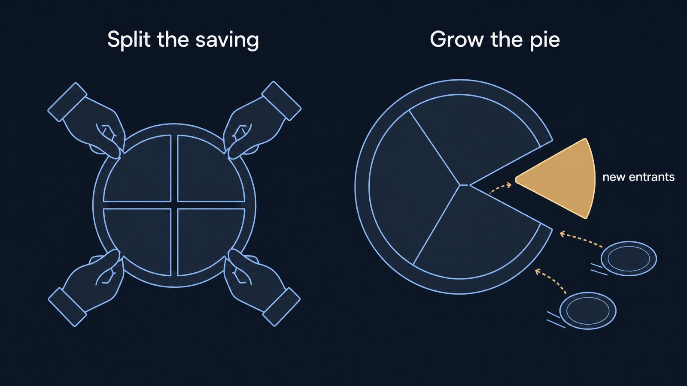
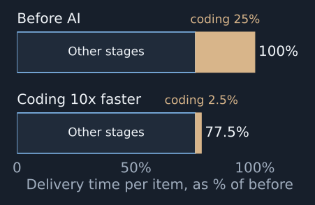

When AI lowers a company's costs, the saving need not stay in one place: a single rollout can benefit several groups at once. How much each group keeps depends less on the company than on competition, scarcity and bargaining power in the markets around it. And because AI can also make it cheaper to start a company, it can grow the pie instead of only dividing it.

I started from a video whose host asked who benefits when AI lowers a company's costs, and gave four answers:

- If the company keeps its prices and its profit rises, **shareholders** benefit.
- If the lower cost turns into lower prices, **consumers** benefit.
- If nothing visible changes because the savings are spent on AI, **AI providers** benefit.
- If the payroll savings go to the employees who remain, **the people running the AI** benefit.

It is a good framework because it asks the right question: not "how many jobs will AI replace" but "who captures the value AI creates". Its limit is that it treats the saving as a fixed pie and asks only how the pie is cut.

## 1. The question is incidence

Economists ask a version of this question about taxes. When a tax is imposed, who pays it is not decided by who writes the check. It is decided by the markets around the transaction: in the standard competitive model, the side that is less sensitive to price, the one that can least easily walk away, bears more of the burden. That is called **tax incidence**.

AI-driven cost reductions raise the same question from the other side: who ultimately receives the benefit? The answer depends less on the company that adopted AI and more on how much competition and bargaining power exist in the markets it touches.

The central distinction is:

> **Value creation ≠ value capture.** The party that creates value is not necessarily the party that keeps it.

### Labor value and market price

Suppose a company starts using AI to produce the standardized reports it sells. The method becomes standard in the industry, and a report of the same quality takes less labor to make, even counting the labor that went into its inputs. In Marx's labor theory of value, **a commodity's value is determined by its socially necessary labor time**. That's the time it takes to make it under normal conditions, at the average level of skill and intensity. By that measure, each report has less value even as the industry can produce more reports with the same amount of labor. The report's selling price can still move in a different direction. [Marx, *Capital*, Volume I, Chapter 1](https://www.marxists.org/archive/marx/works/1867-c1/ch01.htm) and [Chapter 3](https://www.marxists.org/archive/marx/works/1867-c1/ch03.htm)

Now look at what the company pays for compute. If companies are willing and able to rent more computing capacity at any given price, effective demand rises. If suppliers can't add capacity quickly, **compute becomes scarcer relative to effective demand, and its price can rise**. For a report producer renting the same amount of compute, the higher rate can eat into its labor savings. [OpenStax, *Principles of Economics*, Sections 3.1](https://openstax.org/books/principles-economics-3e/pages/3-1-demand-supply-and-equilibrium-in-markets-for-goods-and-services) and [3.3](https://openstax.org/books/principles-economics-3e/pages/3-3-changes-in-equilibrium-price-and-quantity-the-four-step-process)

## 2. Four channels, one budget

The host's four outcomes are not alternatives. They are four channels through which a single saving can flow, and a single rollout can distribute its savings across several of them at once.

| What changes | Who benefits | Economic mechanism |
|---|---|---|
| Costs fall, prices stay | Shareholders | Higher profit margin |
| Costs fall, prices fall | Consumers | Larger consumer surplus |
| Spending shifts to AI | AI infrastructure and service providers | Revenue for an input supplier |
| Fewer staff, higher pay for those who stay | Remaining employees | Productivity gains shared with labor |

A hypothetical example. A SaaS company spends $10M a year building and maintaining its product. After adopting AI it:

- saves $4M in labor costs,
- spends $1M on AI APIs and infrastructure,
- gives up $1M of revenue through lower prices, at the same sales volume,
- gives its core engineers $500K in raises,
- keeps the remaining $1.5M as extra profit.

With sales volume, product quality and other costs unchanged and the AI bill expensed this year, here is how the company uses the $4M in gross labor savings:

```text
$4.0M saved = $1.0M AI vendor + $1.0M customers + $0.5M employees + $1.5M more operating profit (the shareholders' channel, before tax)
```



The last channel is not a payment: the $1.5M is operating profit before interest and tax, and shareholders may benefit through payouts or a higher share price. This is a budget, not a welfare calculation: it ignores new customers, better products and everything else that changes when a company adopts AI. Still, it makes the point. The interesting question is not *which* group benefits but *how large each share is*. Each share is set in a different market, so the next three sections take them one market at a time.

## 3. Product market: competition decides shareholders versus customers

Whether the saving stays as profit or turns into lower prices depends first on what kind of cost AI reduced. Economists call the fraction of a cost change that reaches the price the **pass-through rate**, and it works differently for two kinds of cost:

- **Marginal cost**, the cost of serving one more customer: support tickets, document processing, per-unit labor. A profit-maximizing company sets its price with marginal cost in mind, so a cut here can show up in prices fairly directly.
- **Fixed cost**, the cost that does not grow with sales: most of the engineering in the SaaS example above. In a static model where demand, product quality, marginal cost and the set of competitors stay the same, a lower fixed cost does not change an operating company's profit-maximizing price. It can reach customers indirectly, if lower entry costs bring credible new competitors into the market and push prices down over time.

How much of a marginal-cost cut reaches the price then depends on competition and on the shape of demand:

- **Strong market power.** Nothing forces a dominant company to cut prices; it cuts only as far as maximizing its own profit requires. In the simplest textbook case, a monopolist facing linear demand with constant marginal cost lowers its unit price by half of the cost reduction. That result depends on the linear demand curve: with other demand shapes, a monopolist can pass on less, or even more than the full cost change.
- **Many close competitors.** If a dozen companies sell nearly identical products and all of them adopt the same AI, the cost cut tends to become a price war. Under perfect competition, with free entry, the same technology available to everyone and industry costs that do not rise as output expands, the long-run price falls to the new cost, and the saving reaches customers.

So the split tends to move over time:

- **Short run:** early adopters may keep much of the saving as temporary profit, though customers can benefit right away where marginal costs fall.
- **Long run:** in markets where entry is open and the technology spreads, a large share of it ends up with customers.

## 4. Labor market: productivity gains do not automatically become raises

Suppose every software engineer becomes five times more productive with AI. Will engineering salaries rise fivefold?

Not necessarily. Productivity matters, but wages also depend on how much demand there is for the work, how many people can supply it, how easily AI substitutes for it, and how much bargaining power workers have. If AI lets many more people do the same work, the supply of software development effectively rises, and the gain does not have to flow to the people doing it. The returns tend to go instead to whoever controls what remains scarce: customer relationships, distribution, proprietary data and key business processes. Economists call the return above what is needed to keep a resource in its current use **economic rent**.

The framework also leaves out **displaced workers**. If 30 people can now do what 100 did, the other 70 may take a large loss of income. Even if the gains to shareholders and customers exceed that loss, a richer society is not the same as everyone being richer. Economists separate the two: an outcome where the winners *could* compensate the losers (the Kaldor–Hicks criterion) is not one where they *do*.

## 5. Input market: AI vendors need pricing power, and revenue is not profit

The host's third outcome, where all the savings go to AI spending, deserves a closer look.

Say a company saves $10M a year with AI, and its AI provider charges $8M. The company nets only $2M. Whether that bill holds up depends on two things:

- **The provider's markup.** If models are interchangeable and competing on price, competition pushes the price down toward the provider's own cost. If a model or platform has capabilities that are hard to replace, the provider can charge well above cost and capture more of the value.
- **The usage and the cost of serving it.** Even in a fully competitive market, a large bill can persist if the workload is heavy and expensive to run. Competition limits the markup, not the total.

The growth of AI usage therefore does not guarantee that AI providers' profits grow with it.

There is a second correction. Even when a company hands its whole payroll saving to an AI provider, the provider gets **revenue**, not necessarily **profit**. GPUs, energy, data centers and inference compute all cost money, so vendor revenue should not be equated with profit, and the value can keep moving upstream to whoever controls the scarce inputs there.

## 6. The pie is not fixed

The biggest limitation of the four-way split is that it only redistributes a saving inside companies that already exist. AI may also lower the cost of starting a company.



Suppose an enterprise SaaS product used to need:

- 20 engineers,
- $5M of initial capital,
- two years of development.

For illustration, assume AI lets a five-person team build the same product with $500K over six months.

That is not an existing company cutting costs. It makes business models viable that were not viable before. New founders can enter the market, build products that did not exist, and take customers from incumbents. Lower entry costs can also discipline incumbents, but only when potential entrants could credibly reach customers and compete at meaningful scale. Customer acquisition, switching costs, regulation and distribution can keep that threat weak even when building the product gets cheap. The people who benefit are still owners and customers, but these gains come from new activity rather than from splitting a saving inside an incumbent firm, which is what the four-way split cannot see.

Demand can grow too. When something gets cheaper, people often use more of it. In *The Coal Question* (1865), William Stanley Jevons argued that more efficient steam engines had increased Britain's total coal consumption rather than reducing it. Greater usage does not necessarily mean greater spending, though: total spending on AI-made software, analysis or design rises only if the extra usage more than offsets the lower price per unit. If the price halves, usage has to more than double; a 60% increase in usage would leave spending 20% lower.

## 7. Short-run rents, long-run competition

The time dimension ties the sections together. The table below is illustrative, a sketch of how the split tends to shift as a market matures, not a forecast of actual proportions. The later column assumes adoption spreads and entry stays open; neither is guaranteed.

| Who | Short run: early-adopter lead | Later, if adoption spreads and entry stays open |
|---|---|---|
| Shareholders | Often the larger share, from temporary margin gains | Shrinks, except where a moat keeps rivals out |
| Consumers | Some, mainly where marginal costs fall | Grows as savings turn into lower prices |
| AI providers | Depends on how differentiated the models are | Revenue may keep growing; margins shrink if models commoditize |
| Employees | Concentrated in people with hard-to-supply skills | Follows bargaining power and how hard the skill is to supply |

For investors and founders I think this is the most important judgment of all:

> Who can earn excess profit from AI in the short run, and who can keep it in the long run, are two completely different questions.

If AI cuts the cost of producing code by 90% and every software company has comparable AI tools, access to those tools alone provides little differentiation. Proprietary software, reliability and engineering execution can still matter, but the long-run winners are more likely to be companies that add customers, brand, distribution, network effects, unique data or deep workflow integration on top.

That is why the AI application layer is worth watching for startups, but "AI cuts the cost of this job by 90%" is not enough to call something a good business. The question to ask is: *when every competitor can also cut its coding costs by 90%, why will customers still pay me?*

## 8. Sharing the gains: AI taxes and public equity

Section 4 ended on a gap: the winners *could* compensate the people who lose income, but markets do not make them. If AI shifts income from wages to profits, two concerns follow. People without shares may miss out on capital gains, even while they benefit from lower prices. And a tax system that relies heavily on wages may find that its base grows more slowly than the economy. That is why proposals to tax AI companies, or to give the public a stake in them, have moved from essays into politics. Some would redistribute income; others would also broaden capital ownership.

As of November 15, 2026, these are some of the proposals and corporate arrangements on the table. They differ in who controls the shares and in legal status, and none of them is settled policy:

| Who | What | Status |
|---|---|---|
| OpenAI | The Financial Times reported that Sam Altman had discussed a 5% stake in OpenAI for a government-run fund; this was a reported proposal, not a publicly announced commitment ([TechCrunch](https://techcrunch.com/2026/07/02/openai-proposed-donating-5-of-its-equity-to-a-us-sovereign-wealth-fund/), [CNBC](https://www.cnbc.com/2026/07/02/openai-proposes-us-government-own-5percent-stake-to-address-political-blowback.html)) | The 5% figure was reported in July 2026 as preliminary discussions, rather than an announced agreement. In a statement published by [The Washington Sun](https://www.washingtonsun.com/technology/sam-altman-privately-rejected-open-ai-government-equity) on September 9, 2026, OpenAI said it supports a "government-administered public wealth fund" but would not support the government taking a "controlling or ownership stake in AI companies"; it said it had discussed with policymakers whether AI companies could contribute equity to help seed such a fund, but was "not close to anything specific" |
| Anthropic | Contributed 846,840,960 shares to the Anthropic Public Benefit Fund, a wholly owned subsidiary. That is 5% of its fully diluted shares as of June 30, 2026, assuming its Amazon notes convert in full. At its discretion, the board may contribute additional shares equal to up to 2% of a share base defined in the filing each time the share price rises 50% above the previous milestone, starting from the IPO price. A milestone counts only if the stock closes above it on at least 90 of the trailing 120 trading days, and the average closing price over the ten trading days before the contribution is also above it ([S-1](https://www.sec.gov/Archives/edgar/data/2130357/000162828026067168/anthropicpbc-sx1.htm)) | Disclosed in its October 26, 2026 IPO filing; the shares sit in the company's own fund, not with the government or the public |
| Sen. Bernie Sanders | The American AI Sovereign Wealth Fund Act: a tax paid in newly issued equity (stock, for a corporation) that would leave the government holding 50% of covered companies, with later equity issuances taxed too. It covers businesses with more than $200 million a year in combined gross receipts from AI data centers, AI computing infrastructure, AI services or advanced robotics, as the bill defines them; companies that mix these with other businesses would have to separate them, and the tax would apply to the separated entity ([bill text](https://www.sanders.senate.gov/wp-content/uploads/AmericanAIWealthFundTextv618.pdf), [press release](https://www.sanders.senate.gov/press-releases/news-sanders-introduces-legislation-to-create-7-trillion-ai-sovereign-wealth-fund/)) | Introduced June 18, 2026; not law |

[Lawfare](https://www.lawfaremedia.org/article/scaling-sovereign-wealth--evaluating-mechanisms-for-the-u.s.-government-to-own-parts-of-ai-companies) surveys the mechanisms, from revenue sharing to golden shares. The framework from the earlier sections raises four questions about all of them.

**Who actually bears an AI tax?** Section 1 applies directly: the company that writes the check is not necessarily the one that bears the burden. Who does depends on what is taxed, how sensitive supply and demand are to price, and the time horizon. A tax that raises the cost of each unit of AI, such as a per-token or "robot" tax, can be passed on to the businesses that buy AI and through them to their customers, and it tends to discourage adoption, though it could be justified where AI use imposes costs on others. A one-time levy on existing equity works differently. If it is unexpected and credibly never repeated, it falls mainly on the shareholders who own the stock when the policy is announced, because the loss is priced in at once. The Sanders bill does not fit that model exactly, since it also taxes later equity issuances. A tax on *economic rent*, the profit above what is needed to keep a company investing, distorts investment far less, but only if it properly allows for investment costs, a normal return and losses. Not every profit tax is a rent tax.

**Taxing the right base.** Sections 5 and 7 suggest that model providers may not end up with most of the profit. If models commoditize, the gains may go to the businesses that use cheap AI, to their customers, or upstream to whoever controls scarce chips and energy. A policy aimed only at the leading labs could miss much of the AI dividend. The alternative is to tax profits or capital income broadly. A broad base avoids having to identify AI-specific profits, though avoidance and capital mobility remain concerns.

**Equity versus cash.** Receiving shares avoids an immediate cash payment from companies that may not yet be profitable, and it lets the public share in growth that has not happened yet. It also dilutes existing shareholders, and it leaves the fund exposed to valuation risk, limited liquidity and holdings that rise and fall together, the same correlation problem discussed in Section 9. Voting shares add questions about the government's role in corporate governance.

**How much money is it?** In its June 18 announcement, Sanders's office estimated the proposed 50% stake at about $7 trillion, which implies roughly $14 trillion of equity in the covered companies. The bill would authorize annual appropriations equal to 5% of the fund's average market value, minus reasonable administration costs, for direct payments and public services, and it says payouts may not require the fund to sell the shares it holds. An authorization is not a guaranteed cash payment. The illustration below assumes valuations stay put, enough cash is available without selling shares, administration costs are ignored, the whole 5% goes to equal direct payments, and about 340 million Americans receive them:

| Public stake in the same covered companies | Fund size | Illustrative annual amount at 5%, before costs | Per person per year |
|---|---|---|---|
| Illustrative 5% stake across the companies covered by the Sanders bill | $700B | $35B | about $100 |
| 50% (the Sanders bill) | $7T | $350B | about $1,000 |

This is a hypothetical model, not a forecast. Real payouts depend on the fund's returns, costs, legal limits, and where the cash comes from: a fund that holds mostly stock in companies paying little or no dividend, and that may not be forced to sell, could struggle to find the cash for 5% a year. Even so, the arithmetic makes one point clear. Under equal division, a 5% stake is large in absolute terms but small per person, and even the 50% version pays about $1,000 a year, far less than a lost salary. Public equity and AI taxes can complement wages, but in this scenario they would not replace the income of people whose jobs disappear.

My own read: sharing AI gains through public ownership and taxation is likely to remain a major policy debate, but nothing yet suggests a standard where every leading AI company hands the government 5%. The outcome will depend on where AI profits accrue, on legislative choices and on legal constraints, and different mechanisms may coexist.

## 9. What this means for a long-term investor

The same framework turns into a checklist. None of this is a recommendation to buy or sell anything; it is a way to ask better questions about where AI value ends up.

**Follow the scarcity, not the usage.** AI usage can keep growing while profits move between layers. In each layer of the stack (chips, energy, data centers, models, applications) ask what is scarce today and how fast new supply can arrive. A bottleneck earns rents only until capacity catches up. As supply expands, those rents may erode into lower prices for everyone downstream, and other bottlenecks may or may not emerge.

**Separate temporary margins from durable ones.** When a company reports better margins after adopting AI, ask whether its competitors can adopt the same tools. If they can and entry is open, Section 3 suggests the margin gain drifts to customers over time. Durable gains come from companies whose moat (distribution, data, network effects, switching costs) lets them keep the saving after everyone else has it too.

**Compare returns with the cost of capital, not revenue with spending.** For AI providers and infrastructure builders, the important number is not how fast revenue grows but whether the return on the capital invested exceeds what that capital costs. Heavy capital spending in a market heading toward commodity pricing can produce large revenue and weak returns at the same time.

**Ask what the price already assumes.** A company that will capture AI value is not automatically a good investment. If the market already expects that outcome, the share price reflects it. An investor who pays that price can still earn the normal return the price implies if expectations are met, but returns above that depend on favorable surprises, such as cash flows better than what was priced in or a fall in the return investors demand, and a disappointment can mean a loss even for a company that wins. The question is not only "who wins?" but "how much winning is already in the price?"

**Remember who wins in competitive markets.** In industries with fierce price competition, AI savings mostly reach customers. As a consumer you collect that benefit anyway. As an investor, a company in a commodity business that adopts AI well may still not reward its shareholders.

**Think about how your career and your portfolio move together.** For many people with substantial working years ahead, future labor income is a major economic asset, and it is exposed to AI in a specific way. It is tempting to treat AI-linked assets as a hedge: if the gain shifts from labor to capital, you own part of the capital. Whether that actually works depends on how those assets' returns move with the shocks to your income. A recession, or a fall in AI valuations, can hurt your job prospects and those assets at the same time, and holdings spread across several AI layers can still move together. Check that correlation before counting on the hedge.

## 10. What this means for your career

Section 4 is the uncomfortable one for anyone who works for a salary: productivity gains do not automatically become pay gains. Demand for the work, the supply of people who can do it, and bargaining power decide the outcome. That suggests a few directions, each worth testing against your own situation.

**Lean toward work that AI complements rather than replaces.** AI can lower the cost of supplying some tasks; whether customers then pay less, and the people who used to do them earn less, depends on competition, demand and bargaining power. Work that AI makes *more* valuable has a better chance of commanding a premium, especially if demand for it grows faster than the number of people who can do it: judging whether an output is right, owning the outcome and the accountability, understanding a business well enough to know which problem is worth solving, and earning the trust of customers and colleagues.

**Build skills that stay scarce and travel with you.** Section 4 named the assets that collect the rent: customer relationships, distribution, proprietary data and key business processes. Knowing a customer is not the same as owning that relationship, and access to your employer's data will not necessarily travel with you. What you can carry is deep domain knowledge, judgment about workflows and a reputation people will follow. Reduce your dependence on tasks whose market value may fall as AI makes them easier to supply, such as routine code or first drafts, and build the domain knowledge and judgment that complement them.

**Move early, and make sure it shows.** Section 7 applies to people as well as companies: early adoption may create a temporary advantage, and the window narrows as adoption spreads. Workers are more likely to capture that advantage when they have the bargaining power or contractual arrangements to share in the gains. But early adoption can mainly benefit your employer if the extra output is simply absorbed. Make sure it turns into scope, responsibility or pay.

**Look at your employer's market and your own bargaining power.** Where a company keeps its AI savings, part of that surplus can be shared with the employees who remain, but only if they have the bargaining power to claim it; a profitable company can still cut staff. Where the industry is a price war, the saving goes to customers and the pressure often lands on headcount, though a company that grows by cutting prices may also hire. Ask both questions: how resilient is the business, and how replaceable am I in it?

**Consider becoming the new entrant.** Section 6 is the most hopeful part of the post for individuals: AI may lower the cost of testing some product ideas enough that a small team, or a single person, can try what used to need a funded startup. Even if you stay employed, a small side project is a low-cost way to learn where new value is being created.

**Build a buffer.** The 70 people in Section 4 are a hypothetical example, but the displacement risk behind them deserves practical preparation. Savings, an up-to-date network and a habit of learning can make a job transition easier to manage if your role disappears.

## 11. A hypothetical case: when coding gets ten times faster

Consider a software company whose developers adopt AI and, for the sake of argument, can implement the same change, to the same quality standard, in one-tenth of the coding time. With AI, the company keeps last year's prices and headcount, retains enough customers to match last year's revenue, keeps total pay and all other non-AI operating costs unchanged, and expenses the AI bill this year. Both scenarios for this year face the same competitors. Where did the gain go?

It helps to sort Section 2's channels by the four relationships every company has: the people who own it, the people who work for it, the people who buy from it, and the suppliers it buys from. Here the relevant supplier is the AI provider. As a mnemonic:

```text
effects of AI = AI vendor + customers + employees + shareholders
```

Unlike the dollar breakdown in Section 2, this is not an equation you can add up. The vendor's bill is revenue to the vendor, the shareholders' line is a change in profit, and what customers and employees receive may never be priced at all. It is a checklist of where to look: start with the change in operating profit, then ask what changed for customers, for employees and for the supplier.

| Party | How it can benefit | What tends to set its share |
|---|---|---|
| AI provider | Subscriptions and token fees | Pricing power: substitutable models compete prices down; a differentiated provider may sustain a markup |
| Customers | Lower prices, or more features and faster fixes at the same price | Competition and cost type: prices fall most readily when AI cuts the cost of serving each customer and rivals can make the same saving; cheaper development reaches customers mainly through better products or new entry (Section 3) |
| Employees | Raises, or a lighter workload at the same pay | How scarce and hard to replace they are, and how much bargaining power they have (Section 4) |
| Shareholders | Higher margins, from fewer hires or higher prices | Whether the company has a cost or product advantage rivals cannot readily match: data, customer relationships, switching costs |

Two mechanisms sit behind the table. In a competitive market, an industry-wide cut in unit costs reaches buyers more fully when demand is less elastic relative to supply. In a negotiation, a party that is hard to replace or has a credible alternative is better placed to secure a share; a party that is locked in is worse placed.

Applied to the case, the puzzle resolves. Under these assumptions, operating profit falls from last year by the amount of the AI bill. That year-over-year drop is what the company sees, and it is why AI can look like a pure cost. The effect of adoption is a different comparison: this year's profit against what profit would have been this year without AI. A hypothetical example: last year operating profit was $1M; this year it is $900K after a $100K AI bill. Without AI, assume that in the same year slower delivery would have cost $150K of contribution margin through lost renewals, leaving operating profit at $850K. Profit fell $100K year over year, yet adoption added $50K of operating profit against that baseline. What shareholders finally receive still depends on taxes, payouts and valuation. The AI provider collects its bill. Customers benefit if the team ships improvements sooner at the same price. Employees benefit if the time saved lightens their workload, a real gain that never appears in a financial statement.

Three caveats keep the checklist honest.

**Only realized gains get divided.** Writing code is one stage of delivery. Requirements, review, testing, release and customer adoption do not get faster just because coding does. If coding accounts for a quarter of elapsed delivery time and the stages run in sequence, a tenfold coding speedup leaves one item taking 77.5% of its old delivery time (`75% + 25% ÷ 10`), 22.5% less, by Amdahl's law. The quarter is an assumption for illustration, not a measurement. The unchanged stages now account for about 97% of the time to deliver one item, and team throughput still depends on queues and on which stages have spare capacity.



**Some of the gain is a loss avoided.** Reported revenue already includes the customers the company kept. What the statements cannot show is how many would have left if competitors had adopted AI and this company had not. Judging the return means comparing operating profit with and without AI under the same competitive assumptions, and that requires a counterfactual estimate.

**Competitors and tax policy also shape who benefits.** Competitors and new entrants (Section 6) influence how much reaches customers, and corporate and shareholder taxes affect how much of any profit gain investors ultimately keep.

### How a software company can capture a share

Over time, the company can turn freed capacity into lower spending, additional sales, or a product customers will pay more for. The levers below are not ranked by how common they are; the last column is the test for whether each one pays.

| Lever | What it means | It pays if |
|---|---|---|
| Freeze hiring and let attrition shrink the team | No layoffs, but departures are not replaced | Payroll saved exceeds the cost of AI, rework and any business lost through slower delivery |
| Use the same people to build more products or enter more markets | Grow the pie: when something gets cheaper, demand for it can rise (Section 6) | Extra revenue exceeds all the extra cost |
| Charge separately for AI features, or price on usage or on outcomes | Usage pricing charges for consumption; outcome pricing charges for a defined result; either can replace or sit alongside a seat fee | Extra revenue covers the extra cost plus the margin of any customers who leave; competitors that include comparable features at no extra charge can limit what customers will pay |
| Cut contractors and outsourcing | Remove external costs first | The saving recurs and exceeds the added AI and rework costs |
| Build a moat: proprietary data, customer relationships, distribution, switching costs | Make the gain hard for rivals to compete away | The moat holds; this is what sustains above-normal returns in long-run competition |

In one line: **productivity raises pay mainly where demand for the skill grows faster than its supply and workers can bargain for a share, and an efficiency gain is most exposed to competition when it cuts the cost of serving each customer.** An industry-wide cut in that cost can lower prices; a cut in fixed development cost can stay with incumbents in the short run even when rivals copy it, and reaches customers through better products or new entry over time (Section 3). An early adopter's lead over rivals tends to be temporary unless something stops them from catching up (Section 7).

## 12. Ask who is hard to replace

The four-way split shows where an AI saving can go; it does not show where the saving stays. When rivals can match a cut in the cost of serving each customer, competition can pass some of the saving through in lower prices. Lower development costs can raise profits in the short run and make entry easier over time. Who keeps a lasting share depends on what remains scarce and who can bargain for it: a customer relationship, distribution, proprietary data, a skill few people can supply, or the chips and energy further upstream.

So when a company, a vendor or an employer announces an AI efficiency gain, ask who in that chain is hard to replace. Together with how easily rivals can copy the cut, the answer says more about who keeps the gain than the size of the saving does, and it is the same question for an investor choosing a layer of the stack and for a worker choosing which skills to build.

What remains open is policy. If the gains settle with the owners of scarce assets, the unsolved design problem is how a public fund or a broad profit tax could support workers whose wages fall, including in years when a fund's holdings pay out little cash.
